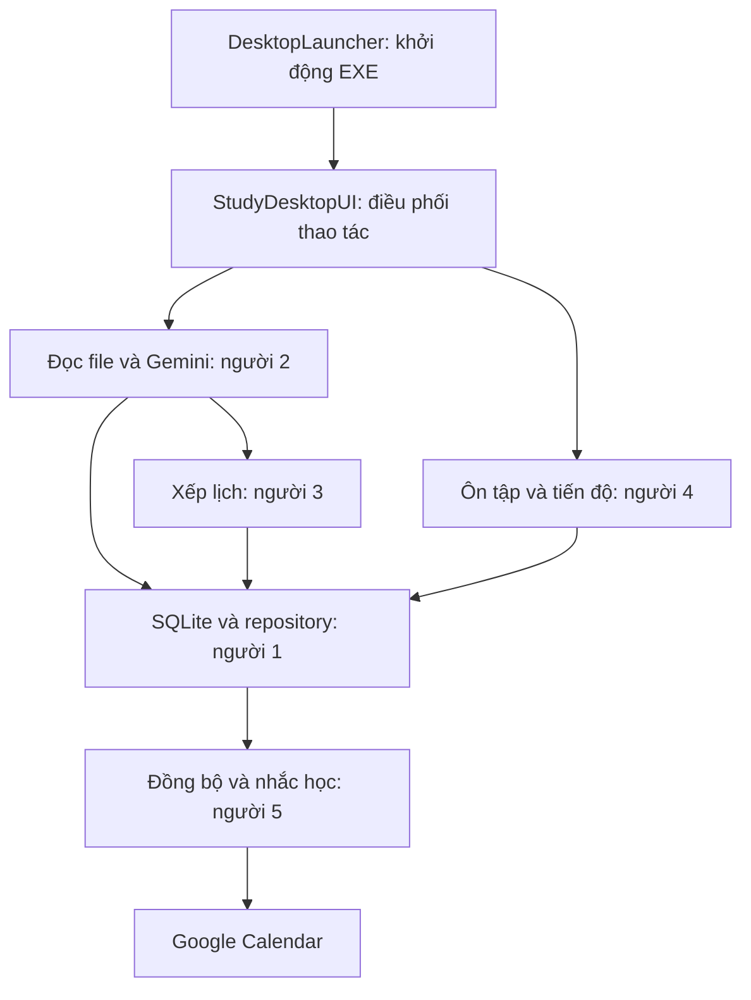

# Phân chia backend cho 5 người

Tài liệu này chia trách nhiệm đọc hiểu theo mã nguồn hiện có; không tách ứng dụng thành 5 dịch vụ và không thay đổi chức năng. Mỗi người đọc một phần chính, sau đó trao đổi tại các điểm giao nhau. Bảng chú thích trong mỗi phần giải thích nhiệm vụ của từng file.

| Người | Phần phụ trách | Tài liệu |
|---|---|---|
| 1 | Khởi động, cấu hình, cơ sở dữ liệu | [Phần 1](01-du-lieu.md) |
| 2 | Đọc file, nhận diện chương, gọi Gemini, soạn đề cương | [Phần 2](02-tai-lieu-ai.md) |
| 3 | Thuật toán xếp lịch và gộp ca | [Phần 3](03-xep-lich.md) |
| 4 | Câu hỏi, đề thi, tiến độ và thời gian tập trung | [Phần 4](04-on-tap-tien-do.md) |
| 5 | Google Calendar, đăng nhập OAuth và nhắc học | [Phần 5](05-dong-bo.md) |

## Luồng tổng thể cần đọc chung

Điểm vào EXE là [DesktopLauncher.java](../../src/main/java/com/studyagent/DesktopLauncher.java). [Main.java](../../src/main/java/com/studyagent/Main.java) khởi động cùng giao diện desktop khi chạy qua Maven. Xem thêm [run.bat](../../run.bat).

**Ranh giới backend hiện chưa tách hoàn toàn khỏi giao diện:** một số thao tác như chọn chương, bắt đầu/hoàn thành ca, đếm giờ và nộp bài vẫn nằm trong các lớp `ui`. Những file UI được dẫn ở từng phần là điểm nối cần đọc; không có nghĩa toàn bộ giao diện thuộc backend.

**Các lớp kiến trúc cũ:** `agent/StudyAgent`, `task/*`, `parser/AIParser`, `GeminiAIParser`, `RegexAIParser`, `StudyRequest`, `scheduler/Scheduler`, `Schedule`, `pomodoro/*`, `repository/Repository`, `SqliteRepository` là luồng tác vụ/Pomodoro riêng. Không dùng chúng để giải thích thay cho luồng nhập giáo trình → đề cương → ôn tập của desktop hiện tại. Các chú thích `@author Thành viên ...` cũ không phải bảng phân công mới này.

## Quy ước phối hợp

- Người 1 phụ trách schema và cách truy cập SQLite; người 4 giải thích nghiệp vụ ngân hàng câu hỏi và kết quả dù mã nằm trong repository.
- Người 2 phụ trách cơ chế Gemini dùng chung. Người 4 phụ trách nội dung đầu vào và cách sử dụng câu hỏi tạo ra.
- Người 3 giải thích lịch được tạo thế nào; người 4 giải thích hoàn thành/quá hạn; người 5 giải thích trạng thái đó ảnh hưởng thông báo ra sao.
- Không đưa `config.properties`, `auth.json`, `data/google/token.json` hoặc khóa/token thật lên slide hay kho công khai.
- Khi trình bày kết quả kiểm thử, phân biệt kiểm thử giả lập API với việc gọi Gemini/Google thật. Xem các test được liệt kê trong từng phần.

Mỗi người nên chuẩn bị: sơ đồ đầu vào → xử lý → đầu ra, một ví dụ chạy thực tế và hai tình huống lỗi của phần mình.
